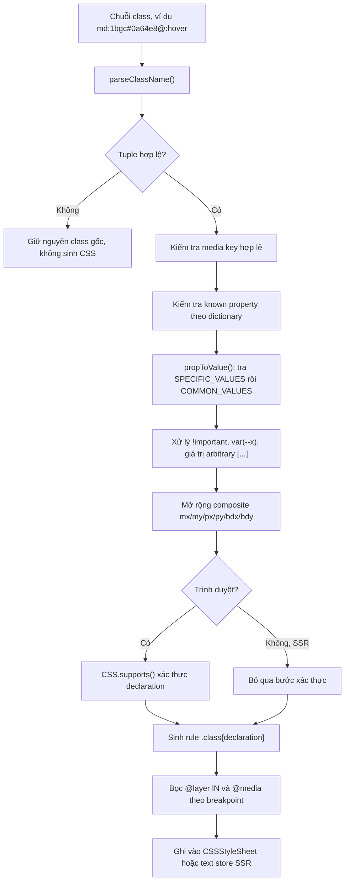
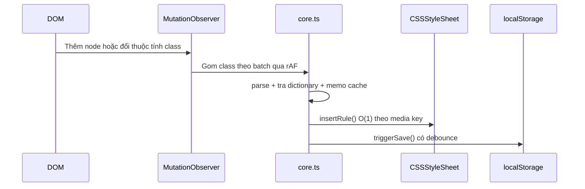

# Kiến Trúc PresenceStyle

Tài liệu này mô tả kiến trúc hiện tại của `@porbit/style`, gồm phân tách module, luồng dữ liệu, luồng runtime, và quan hệ với engine Rust `presence_style`.

## 1. Tổng Quan

`PresenceStyle` là utility CSS engine: nhận chuỗi class viết tắt (ví dụ `md:1bgc#0a64e8@:hover`), phân tách thành các thành phần ngữ nghĩa, tra từ điển, và sinh CSS thật theo `@media` + `@layer`.

Engine hoạt động ở hai chế độ:

1. **Runtime trình duyệt**: theo dõi DOM bằng `MutationObserver`, sinh CSS ngay khi class xuất hiện.
2. **SSR / build-time**: không cần DOM, sinh chuỗi CSS tĩnh để ghi ra file hoặc nhúng vào HTML.

## 2. Phân Tách Module

| File | Vai trò |
| :--- | :--- |
| `src/parser.ts` | Tách một chuỗi class thành tuple `{ mq, layer, prop, val, selector }`. Không phụ thuộc DOM và không phụ thuộc dictionary. |
| `src/dictionary.ts` | Ba bảng tra: `SHORT_PROPERTIES` (406 prop), `COMMON_VALUES`, `SPECIFIC_VALUES`. |
| `src/core.ts` | Engine chính: phân giải giá trị, dựng rule CSS, quản lý stylesheet, cache `localStorage`, đồng bộ đa tab, quan sát DOM. |
| `src/index.ts` | API công khai và shared instance dùng chung theo `globalThis`. |
| `src/index-auto.ts` | Entry tự động gọi `cssObserve(document)` khi import; dùng cho thẻ `<script type="module">`. |
| `src/extract.ts` | Trích xuất CSS tĩnh: quét chuỗi nguồn lấy class ứng viên và sinh CSS ở chế độ SSR. |
| `src/cli.ts`, `src/cli-bin.ts` | CLI `presence-style` cho pipeline build. |
| `src/bootloader.ts` | Sinh đoạn script nhỏ nạp CSS từ cache `localStorage` trước khi bundle chính chạy. |
| `src/tailwind.ts` | Chuyển đổi utility kiểu Tailwind sang cú pháp x-css. |
| `src/tailwind-readiness.ts` | Đánh giá mức độ an toàn khi migrate tự động từ Tailwind. |
| `src/events.ts` | Emitter tối giản (`mitt`) nội bộ, không phụ thuộc thư viện ngoài. |

Nguyên tắc phụ thuộc: `parser.ts` và `dictionary.ts` là tầng thuần logic, không import `core.ts`. `extract.ts` và `cli.ts` chỉ dùng API công khai của `core.ts`.

## 3. Luồng Dữ Liệu Của Một Class



Thứ tự tách token là bắt buộc và khớp `spec/SPEC.md`: selector (`@` cuối cùng ngoài `[]`) → media (`:` đầu tiên ngoài `[]`) → layer (chữ số đầu) → property → value.

## 4. Luồng Runtime Trình Duyệt



Điểm quan trọng:

1. **Lần quét đầu tiên chạy đồng bộ** để CSS kịp áp dụng trước first paint, giảm CLS. Sau đó chuyển sang batch bất đồng bộ để không chặn UI.
2. **Memo cache** (`classToPropCache`, `propToValueCache`, `cssSupportsCache`) tránh parse lại cùng một class. Các cache này bị chặn trần bởi `maxCacheEntries`.
3. **Một stylesheet cho mỗi media key**, nhờ đó thêm rule mới là `insertRule` O(1) thay vì dựng lại toàn bộ CSS.

## 5. Quản Lý Stylesheet Và Khả Năng Hạ Cấp

| Năng lực | Khi có hỗ trợ | Khi không hỗ trợ |
| :--- | :--- | :--- |
| `adoptedStyleSheets` | Dùng `CSSStyleSheet` dựng được, gắn một lần theo lô | Tạo thẻ `<style data-presence-style="...">` thật |
| `@layer` | Bọc rule trong `@layer lN` | Sinh rule trần, giữ thứ tự theo thứ tự chèn |
| `CSS.escape` | Dùng bản trình duyệt | Polyfill bám sát CSSOM trong `core.ts` |
| `CompressionStream` | Nén cache `deflate-raw` + base64 | Fallback LZW |
| `BroadcastChannel` | Đồng bộ key giữa các tab | Fallback sự kiện `storage` |

## 6. Cache Và Sinh Tên Class

Khi bật `cache.loadOnInit`, engine giữ một registry `class nguồn -> key rút gọn` trong `localStorage`.

Registry được nạp một lần vào bộ nhớ và ghi lại gộp theo microtask. Đây là điểm khác biệt so với bản trước: trước đây mỗi class mới đều đọc và serialize lại toàn bộ registry, tạo chi phí O(n²) theo số class của trang.

`configHash` được tính từ toàn bộ cấu hình ảnh hưởng tới CSS sinh ra, gồm cả `hoverMedia` và `autoprefix`. Nếu hash đổi, cache cũ bị loại bỏ thay vì hydrate nhầm.

## 7. Chuẩn Hóa Đa Engine

`PresenceStyle` là nguồn chân lý cho engine Rust `presence_style`:

```text
src/dictionary.ts ──gen-spec──▶ spec/dictionary.json ──gen-rust-dict──▶ x-core/src/dictionary_generated.rs
src/{core,parser}.ts ──gen-spec──▶ spec/conformance.core.json ──▶ x-core/tests/conformance.core.json
```

Hợp đồng conformance so khớp theo tuple ngữ nghĩa `{accepted, media, layer, selector, declarations}`, không so tên class, vì hai engine dùng thuật toán hash và escape khác nhau. Hiện có 3274 case (2681 chấp nhận, 593 từ chối).

Khi thay đổi hành vi engine một cách có chủ đích, phải chạy `npm run gen` để cập nhật lại hợp đồng.

## 8. Ràng Buộc Thiết Kế

1. **Không phụ thuộc runtime ngoài**: package không có `dependencies`, chỉ có `devDependencies`.
2. **An toàn khi không có DOM**: mọi truy cập `window`, `document`, `CSS`, `localStorage` đều có kiểm tra tồn tại.
3. **Không bao giờ làm hỏng class hợp lệ**: token không parse được sẽ giữ nguyên, không bị xoá khỏi DOM.
4. **Vendor prefix chỉ thêm khi hợp lệ**: `autoprefix` kiểm tra `CSS.supports` trước khi chèn declaration `-webkit-`.

## 9. Tối Ưu Runtime Đã Tích Hợp

Bản runtime hiện tại đã áp dụng các tối ưu không làm thay đổi cú pháp hoặc API công khai:

1. `clsx()` duyệt mảng lồng nhau bằng vòng lặp, tokenize theo khoảng trắng trực tiếp, giữ thứ tự xuất hiện và loại trùng một lần.
2. Bộ nhớ CSS SSR/cache dùng các chunk theo media rồi mới `join()` khi xuất, tránh nối chuỗi tích lũy trên đường nóng.
3. Fallback `<style>` gom cập nhật `textContent` theo microtask thay vì parse lại stylesheet sau từng token.
4. Observer quét được nội dung ban đầu của `ShadowRoot`, dùng `Set` khi diff class mutation, tránh `flat(Infinity)`, chống gọi `observe()` lặp và hủy flush đang chờ khi `destroy()`.
5. Khởi tạo `@layer` dùng `ownerDocument` của root, nên không phụ thuộc nhầm vào `document` toàn cục khi chạy trong iframe hoặc document khác.
6. Khi API nhận một `Element`, stylesheet vẫn gắn vào document chứa nó nhưng observer chỉ quét và theo dõi đúng subtree của element đó.

Các thay đổi này chỉ tối ưu thực thi; tuple parser, declaration, selector, media, layer và tên class mặc định vẫn giữ nguyên. Fallback legacy có thể cập nhật style trễ đến microtask hiện tại, nhưng vẫn hoàn tất trước lượt render kế tiếp trong cùng event loop.

## 10. Hướng Mở Rộng Có Kiểm Soát

Không đưa scheduler, plugin hoặc package split vào mặc định khi chưa có benchmark trình duyệt lặp lại. Bước tiếp theo được ưu tiên là:

1. Chuẩn hóa benchmark initial scan, mutation burst, cache và CSSOM trên Chromium/Firefox/WebKit.
2. Tách Rule IR thuần logic khỏi `core.ts`, sau đó dùng chung cho browser, SSR, CLI và engine Rust.
3. Bổ sung chế độ static-first/hydration và adapter Vite sau khi có differential conformance.
4. Chỉ chuyển các năng lực mới thành public API khi có test tương thích, rollback và tài liệu vận hành.
